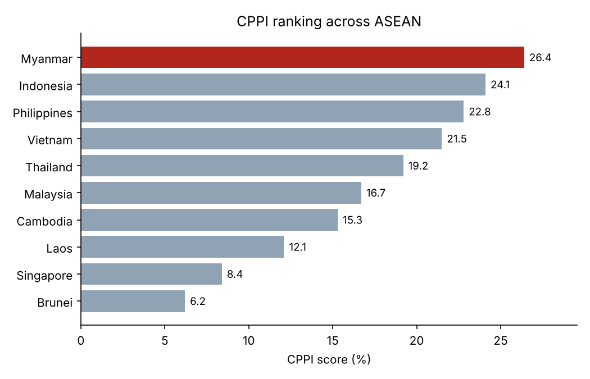

# MettaLimb: From Waste to Wholeness

3D-printed prosthetics made from recycled PET plastic waste, starting with a pilot in Myanmar and scaling across ASEAN.

**Team Data Alchemists** · Albukhary International University (AIU) · Myanmar
Team members: Aung Kaung Myat, Paing Zayar Tun

> **Status: concept and pilot plan.** This repository documents the idea, the data-driven prioritisation model (CPPI), the impact and financial projections, and the planned pilot. The figures are model projections, not measured results.
> <!-- Edit this note to say exactly what you have built or tested so far. -->

## The idea
Two problems, one solution.

- **Plastic waste:** ASEAN generated 23.17 million tons of plastic waste in 2020, and Myanmar has the highest mismanagement risk in ASEAN (83%).
- **Prosthetic access:** more than 35 million people live with limb loss, and access to assistive technology can be as low as 3% in some low-income countries.

MettaLimb connects them: collect PET waste, recycle it into 3D-printer filament, and print custom-fit prosthetic parts close to the people who need them.


Evidence from elsewhere: Rappler and Mizzima (2025) report a free 3D-printed prosthetics programme for Myanmar war amputees that served about 150 patients and produced 40 unique devices in 2025. That is external evidence the approach is feasible, not a MettaLimb result.

## Why start in Myanmar: the CPPI ranking
The **Circular Prosthetic Potential Index (CPPI)** scores ASEAN countries on plastic waste (40%), prosthetic need (30%), recycling readiness (20%) and the accessibility gap (10%).

| Rank | Country | CPPI (%) |
|---|---|---|
| 1 | Myanmar | 26.4 |
| 2 | Indonesia | 24.1 |
| 3 | Philippines | 22.8 |
| 4 | Vietnam | 21.5 |
| 5 | Thailand | 19.2 |
| 6 | Malaysia | 16.7 |
| 7 | Cambodia | 15.3 |
| 8 | Laos | 12.1 |
| 9 | Singapore | 8.4 |
| 10 | Brunei | 6.2 |



Details and the Myanmar breakdown: [docs/cppi-model.md](docs/cppi-model.md)

## Projections (model outputs, not measurements)
- One-time start-up cost: 15,000 units (equipment, technology, workshop, training)
- Revenue 125,000 / 315,000 / 580,000 and surplus 52,600 / 161,400 / 335,000 in Year 1 / Year 2 / Year 3+
- All surplus is reinvested, none distributed
- Target unit cost: $250 in 2026 falling to $150 by 2030

See [docs/financial-model.md](docs/financial-model.md) and [docs/impact-model.md](docs/impact-model.md).

## Repository layout
| Folder | Contents |
|---|---|
| `docs/` | Problem, solution, technical process, models, risks, timeline, finances, references |
| `models/` | Python code for the CPPI, impact and financial models |
| `data/` | CSV inputs with their sources |
| `presentation/` | The pitch deck (add the PDF here) |
| `tests/` | Checks that the code reproduces the numbers in the deck |
| `assets/` | Generated charts |

## Run the models
```bash
pip install -r models/requirements.txt
python models/cppi.py
python models/impact.py
python models/financials.py
python models/make_figures.py
python tests/test_models.py
```

## Documentation
1. [Problem and evidence](docs/problem-and-evidence.md)
2. [Solution and ecosystem](docs/solution.md)
3. [Technical process: PET to prosthetic](docs/technical-process.md)
4. [CPPI model](docs/cppi-model.md)
5. [Impact model](docs/impact-model.md)
6. [Risk register](docs/risk-register.md)
7. [Implementation timeline](docs/implementation-timeline.md)
8. [Financial model](docs/financial-model.md)
9. [Open questions on the models](docs/model-notes.md)
10. [References](docs/references.md)

## Related work
<!-- If the robotic hand in your pilot uses your EMG control design, link that repository here. -->

## License
<!-- Add a LICENSE file (for example MIT for code, CC BY 4.0 for documents and data). -->
