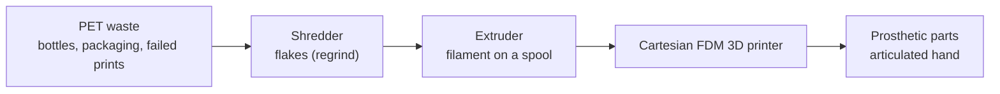

# Technical process: PET to prosthetic

A small, self-contained micro-factory that turns waste plastic into functional 3D-printed prosthetic parts.

| Step | What it does |
|---|---|
| **Shredder** | Waste plastic is fed into a hopper and rotating blades cut it into small, uniform flakes (regrind) |
| **Extruder** | Flakes are melted and pushed through a nozzle by a motor-driven screw, forming a continuous filament that is spooled |
| **3D printer** | A Cartesian-style FDM printer builds objects layer by layer from the recycled filament |
| **Finished part** | An articulated robotic hand powered by a microcontroller and actuators, aiming at a functional grip on a low budget |

## Things to document as you test
These are suggested items to record once you have results. They are not results yet.

- **Drying:** PET absorbs moisture, which degrades it when melted, so record how the flakes and filament are dried
- **Filament consistency:** diameter tolerance along the spool and how it is measured
- **Print settings:** nozzle and bed temperatures, speed, layer height that work with recycled PET filament
- **Material tests:** tensile and bending strength, layer adhesion, dimensional accuracy, compared with commercial filament
- **Quality control:** the pass/fail checks each batch must meet before parts are used on people
- **Fit and function:** socket fit process, grip tests, durability cycles

Record each test with date, settings, sample count and outcome so others can reproduce it.
